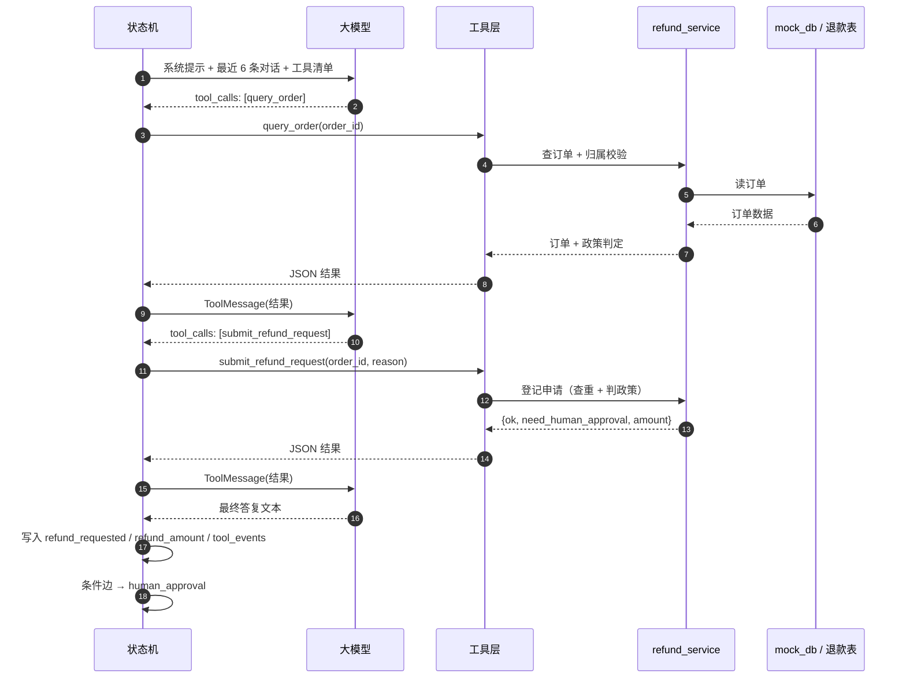

# 工具调用（Function Calling）改造说明

> 改造目标：退费分支不再由代码写死“先查订单、再算政策”，而是把能力做成工具，
> 让模型自己决定查什么、什么时候提交申请；资金安全仍由状态机的审批与幂等兜底。

---

## 1. 改造前后对比

| | 改造前 | 改造后 |
| --- | --- | --- |
| 退费入口 | `router` 直接进 `verify_refund`，顺序写死 | `router` → `after_sales_agent`，模型选工具 |
| 订单查询 | 节点里直接读 `MOCK_ORDERS` | `query_order` / `list_my_orders` 工具 |
| 政策判定 | 节点内硬编码 7 天 / 10% | `check_refund_policy` 工具 + `refund_service` 单一实现 |
| 提交申请 | 校验通过就直接执行退款 | `submit_refund_request` 只登记申请，不碰钱 |
| 可解释性 | 结果固定 | `tool_events` 记录每次调用的入参和结果 |
| 失效兜底 | — | 模型不调工具时，按用户原话走确定性提交 |

---

## 2. 四个工具

定义在 `core/tools.py`，`user_id` 由后端闭包注入，模型只能传 `order_id` / `reason`。

| 工具 | 作用 | 是否写数据 |
| --- | --- | --- |
| `list_my_orders()` | 列出当前用户名下全部订单 | 否 |
| `query_order(order_id)` | 订单详情 + 退费判定 | 否 |
| `check_refund_policy(order_id)` | 只算政策：能否自动退、是否需要人工、退多少 | 否 |
| `submit_refund_request(order_id, reason)` | 登记退款申请 | 是（只登记，不打款） |

工具统一返回 JSON 字符串，例如：

```json
{"ok": true, "order_id": "ORD_002", "refund_amount": 2999.0,
 "need_human_approval": true, "reasons": ["已购买 20 天，超过 7 天无理由退款期限"]}
```

---

## 3. 节点内部循环

`after_sales_agent_node`（`core/agent_workflow.py`）：



细节：

- 最多 `MAX_TOOL_STEPS = 4` 轮，防止模型来回打转；超出后没有答案就用兜底话术。
- 工具异常、未知工具、参数不合法都会转成 `{"ok": false, "error": ...}` 回填，不会打断图。
- 只有 `submit_refund_request` 返回 `ok=true`，才把 `refund_requested` 置为 `True`。
- 节点每轮先重置 `refund_requested / need_human_approval / refund_amount`，避免上一轮的状态串到这一轮。

---

## 3.5 协议层：工具调用到底发了什么

模型不会执行你的代码，它只输出一个“要调哪个函数、参数是什么”的 JSON。
真正的执行发生在你的进程里，分四步：

**第 1 步：请求里带上工具清单**

```json
{
  "model": "deepseek-chat",
  "messages": [{"role": "user", "content": "帮我退掉 ORD_001"}],
  "tools": [{
    "type": "function",
    "function": {
      "name": "submit_refund_request",
      "description": "提交退款申请（只登记申请，不会立即打款）",
      "parameters": {
        "type": "object",
        "properties": {
          "order_id": {"type": "string"},
          "reason": {"type": "string"}
        },
        "required": ["order_id"]
      }
    }
  }]
}
```

`llm.bind_tools(tools)` 干的就是这件事：把 Python 函数的类型注解和 docstring
转成上面的 JSON Schema，挂到之后每次请求上。它**不执行**任何函数。

**第 2 步：模型返回 tool_calls，而不是答案**

```json
{
  "choices": [{
    "message": {
      "role": "assistant",
      "content": null,
      "tool_calls": [{
        "id": "call_abc",
        "type": "function",
        "function": {
          "name": "submit_refund_request",
          "arguments": "{\"order_id\":\"ORD_001\",\"reason\":\"不想学了\"}"
        }
      }]
    },
    "finish_reason": "tool_calls"
  }]
}
```

LangChain 已经把 `arguments` 解析好，放在 `AIMessage.tool_calls` 里，
所以代码里拿到的是 `{"name": ..., "args": {...}, "id": ...}`。

**第 3 步：本地执行工具**

```python
payload = tool.invoke(call["args"])   # 真正调用 Python 函数
```

对应项目里的 `_run_tool()`：查字典找工具、执行、异常转成 `{"ok": false, "error": ...}`。

**第 4 步：把结果作为 ToolMessage 回填，再请求一次**

```json
[
  {"role": "assistant", "content": null, "tool_calls": [{"id": "call_abc", "...": "..."}]},
  {"role": "tool", "tool_call_id": "call_abc",
   "content": "{\"ok\": true, \"refund_amount\": 1999.0, \"need_human_approval\": false}"}
]
```

关键点：`tool_call_id` 必须和上一条 assistant 消息里的 `id` 一致；
assistant 的 `tool_calls` 消息也必须先进入历史，否则接口会报 400。

**第 5 步：循环**

模型看到工具结果后，要么继续调下一个工具（回到第 2 步），要么给出最终文本。
本项目最多循环 `MAX_TOOL_STEPS = 4` 轮，终止条件是“某次响应里没有 tool_calls”。

### 最小可运行例子

```python
from langchain_core.messages import HumanMessage, ToolMessage
from langchain_core.tools import tool
from langchain_openai import ChatOpenAI

@tool
def add(a: int, b: int) -> str:
    """计算两个整数之和"""
    return str(a + b)

llm = ChatOpenAI(model="deepseek-chat", temperature=0).bind_tools([add])
messages = [HumanMessage("3 + 5 等于几？")]

for _ in range(3):
    ai = llm.invoke(messages)
    messages.append(ai)

    if not ai.tool_calls:
        print(ai.content)
        break

    for call in ai.tool_calls:
        result = add.invoke(call["args"])
        messages.append(ToolMessage(content=result, tool_call_id=call["id"]))
```

把 `add` 换成 `query_order`，就是本项目里的实现。

### 常见坑

| 现象 | 原因 |
| --- | --- |
| 接口 400 `tool_calls must be followed by tool messages` | 只 append 了 ToolMessage，没先 append 带 tool_calls 的 assistant 消息 |
| 接口 400 `tool_call_id not found` | `ToolMessage.tool_call_id` 和 assistant 的 `id` 不一致 |
| 模型反复调同一个工具 | 没把结果回填，或结果不是字符串/JSON 而是被丢掉 |
| 并行调用只执行了一个 | 一次响应可能返回多个 `tool_calls`，要 `for` 全部执行、逐个回填 |
| 工具报错把图打断 | `tool.invoke` 没包 try/except，异常直接冒泡 |
| 模型就是不调工具 | prompt 不够明确；本项目用“确定性兜底”保证退款流程不受影响 |

---

## 4. 资金安全的三层设计

1. **工具层**：`user_id` 不在工具参数里，模型伪造别人的订单号也只会得到“未查询到订单”。
2. **流程层**：`submit` 只登记申请，真正的 `REFUNDED` 由 `execute_refund` 节点执行；高风险订单必须先过 `interrupt` 人工审批。
3. **数据层**：`refund_records.order_id` 主键唯一约束，重复请求、消息重放、服务重启都只能成功一次。

另外加了一个**确定性兜底**：如果模型这一轮完全没调工具，但用户原话里明确有
“退款 / 退钱 / 退费 / 取消订单”等词，节点会直接用 `refund_service` 提交申请。
这样即使模型不支持 function calling、或临时抽风，资金链路也不会静默失败；
反过来，模型只是聊政策、没提退款时，不会误触发提交。

---

## 5. 新增/修改的文件

| 文件 | 说明 |
| --- | --- |
| `core/refund_service.py` | 新增：订单查询、政策判定、申请登记（规则唯一实现） |
| `core/tools.py` | 新增：4 个 LangChain 工具，按用户构造 |
| `core/agent_workflow.py` | 修改：新增 `after_sales_agent` 节点，移除 `verify_refund`，修复 HITL 早退 |
| `server/main.py` | 修改：入参复位 `refund_requested/tool_events`，响应返回 `tool_events` |
| `scripts/interactive_cli.py` | 修改：终端打印本轮工具调用 |
| `tests/test_tools.py` | 新增：工具层确定性测试 |
| `tests/test_tool_agent.py` | 新增：用假模型验证工具循环与兜底 |

> 相关图已同步：`docs/运行逻辑.md`、`docs/流程图.md/.svg`、`docs/问答流程图.md/.svg`
> 都画的是工具调用版本。

---

## 6. 怎么验证

```powershell
pytest tests/test_tools.py tests/test_tool_agent.py tests/test_api.py -v
pytest tests/test_regression.py -v -s     # 会真实调用大模型
python scripts/interactive_cli.py         # 终端里能直接看到工具调用
```

预期：

- `tools` 测试不花钱，几秒出结果；
- 回归用例 3（ORD_002）现在应正常返回 `SUSPENDED`，订单保持 `PAID`；
- 回归用例 4（ORD_001）应自动退款，重复调用被幂等拦截；
- CLI 会打印形如 `✅ query_order {'order_id': 'ORD_002'}` 的记录。

### 6.1 用 FastAPI 调试接口测试

`server/main.py` 新增了只用于本地测试的接口（设置 `ENABLE_DEBUG_API=0` 可整体关闭）：

| 接口 | 用途 |
| --- | --- |
| `GET /api/health` | 服务是否启动 |
| `GET /api/debug/orders?user_id=USER_B` | 看内存订单的实时状态 |
| `GET /api/debug/refunds` | 看落库的退款流水 |
| `GET /api/debug/thread/{thread_id}` | 看会话停在哪、interrupt 内容、tool_events |
| `POST /api/debug/reset` | 重置订单、清空退款记录 |

Swagger（`/docs`）里的手测顺序：`health → orders → chat → thread → resume → refunds → reset`。

自动化测试用 `TestClient` + 脚本化假模型，不产生大模型费用：

```powershell
pytest tests/test_api.py -v
```

覆盖：自动退款成功、高风险挂起 + 驳回、未挂起 resume 返回 400、调试接口与重置。

> 说明：`/api/debug/*` 默认开启，方便本地演示；线上部署请设 `ENABLE_DEBUG_API=0`。

---

## 7. 面试时怎么讲

> “我把售后能力拆成 4 个工具，用 function calling 让模型自己决定查订单还是核对政策。
> 但资金动作我没有完全交给模型：`submit` 只登记申请，执行由状态机节点做，高风险订单
> 走 interrupt 人工审批，最后用数据库唯一约束保证幂等。另外我加了一层确定性兜底——
> 模型不调工具时，按用户原话触发提交，避免模型能力波动影响主流程。”

这段能同时体现：**会用 function calling**、**懂权限边界**、**懂幂等**、**知道模型不可靠**。

---

## 8. 还可以继续做

- 用 LangGraph 内置的 `ToolNode` / `create_react_agent` 替换手写循环（代码更短，但可控性略低）；
- 工具并行调用（一次返回多个 `tool_calls` 时并发执行）；
- 把 `mock_db` 换成真实订单服务 HTTP API，工具层加超时、重试、熔断；
- 审批接口加审批人身份与权限（现在只凭 `thread_id`）；
- 给 `submit` 加“预占 + 驳回释放”，让重复提交在提交阶段就能被挡住，而不是等到执行阶段。
