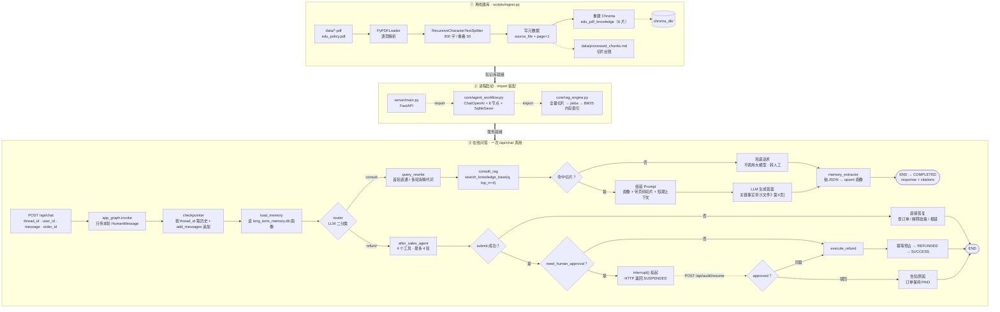
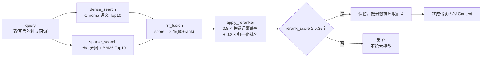
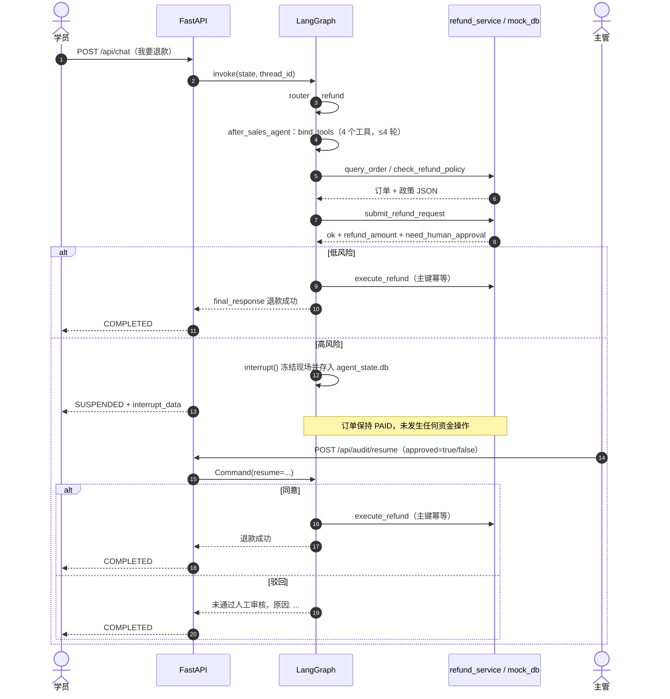
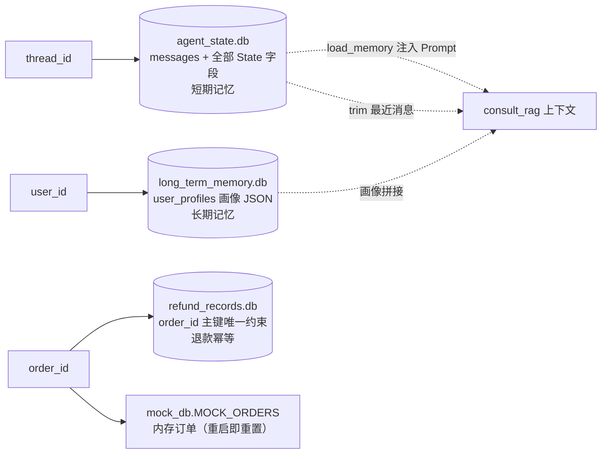

# 全链路流程图（Mermaid 版）

> 配套文件：
> - `docs/流程图.svg`：渲染好的静态图，双击用浏览器打开即可看。
> - `docs/运行逻辑.md`：每个节点的详细文字说明与行号。
> - 退费分支已改为工具调用（`after_sales_agent`），细节见 `docs/工具调用.md`。
>
> 本文用 Mermaid 写成，便于改图；GitHub、VS Code（Markdown Preview Mermaid 插件）、Typora、
> Obsidian 以及 [mermaid.live](https://mermaid.live) 都能直接渲染。

---

## 1. 主流程图（离线 → 启动 → 在线）



> 注：HITL 的早退问题已修复，高风险订单会正常挂起；退费现在由 `after_sales_agent`
> 通过工具调用完成“查订单 / 核政策 / 提交申请”，打款仍由 `execute_refund` 执行。

---

## 2. 检索子流程（`search_knowledge_base`）



关键点：

- 覆盖率是**绝对证据**（查询词真的出现在切片里），排名分只是辅助；
- 覆盖率 0 的切片最高 0.2 分，永远过不了 0.35，从源头拦掉“红烧牛肉面”这类越界问题；
- `normalize_text` 去空白、`extract_query_terms` 丢单字，都是为了让覆盖率别被 PDF 硬换行和虚词干扰。

---

## 3. 退费：工具调用 + HITL 时序图



---

## 4. 记忆与持久化关系



- 短期记忆 = 完整历史存在 `agent_state.db`，但喂给模型的是 trim 后的窗口；
- 长期记忆 = 按 `user_id` 跨会话复用，`memory_extractor` 负责写入；
- 退费幂等 = `refund_records.db` 的主键唯一约束，而不是内存 set。

---

## 5. 节点 → 代码位置对照

| 图中节点 | 代码位置 |
| --- | --- |
| 离线建库全流程 | `scripts/ingest.py` 第 13-89 行 |
| `dense_search` / `sparse_search` | `core/rag_engine.py` 第 36-67 行 |
| `rrf_fusion` | `core/rag_engine.py` 第 70-95 行 |
| `apply_reranker` | `core/rag_engine.py` 第 121-161 行 |
| `search_knowledge_base` | `core/rag_engine.py` 第 164-192 行 |
| `load_memory` / `router` / `query_rewrite` | `core/agent_workflow.py` 第 63-123 行 |
| `consult_rag` / `memory_extractor` | `core/agent_workflow.py` 第 126-210 行 |
| `after_sales_agent`（工具循环） | `core/agent_workflow.py` 第 278-376 行 |
| `human_approval` / `execute_refund` | `core/agent_workflow.py` 第 379-430 行 |
| 工具定义 | `core/tools.py` 第 16-42 行 |
| 退费规则 / 申请登记 | `core/refund_service.py` 第 1-147 行 |
| 建图与编译 | `core/agent_workflow.py` 第 432-471 行 |
| `POST /api/chat` / `/api/audit/resume` | `server/main.py` 第 30-76 行 |
| 画像读写 | `core/memory_manager.py` 第 26-51 行 |
| 退款幂等 | `server/refund_store.py` 第 26-63 行 |
| 模拟订单 | `server/mock_db.py` 第 5-36 行 |

---

## 6. 纯文本速览（终端友好）

```text
[离线] data/*.pdf → PyPDFLoader → 切分 300/50 → 元数据 → processed_chunks.md + chroma_db
                                              │
[启动] import rag_engine：全量切片 + jieba + BM25（内存）
       import agent_workflow：.env + LLM + 8 节点 + SqliteSaver → compile
                                              │
[在线] POST /api/chat
         → checkpointer(thread_id) + add_messages
         → load_memory（long_term_memory.db）
         → router（LLM 二分类）
              ├─ consult → query_rewrite → search_knowledge_base
              │              ├─ 无命中 → 兜底转人工
              │              └─ 有命中 → 带页码生成 → memory_extractor → END
              └─ refund  → after_sales_agent（工具调用：查订单 / 核政策 / 提交申请）
                             ├─ 低风险 → execute_refund（幂等）→ 成功
                             └─ 高风险 → interrupt 挂起 → 人工审批
                                            ├─ 同意 → execute_refund → 成功
                                            └─ 驳回 → 告知原因（订单不变）
```

---

## 7. 怎么渲染

| 场景 | 做法 |
| --- | --- |
| 只想看图 | 双击 `docs/流程图.svg`，用 Chrome / Edge 打开 |
| VS Code | 安装 “Markdown Preview Mermaid Support” 后预览本文件 |
| 在线 | 打开 [mermaid.live](https://mermaid.live)，粘贴任一代码块 |
| GitHub / GitLab | 直接渲染 ```mermaid 代码块（GitHub 已原生支持） |
| 导出图片 | mermaid.live → Actions → PNG / SVG 下载 |
