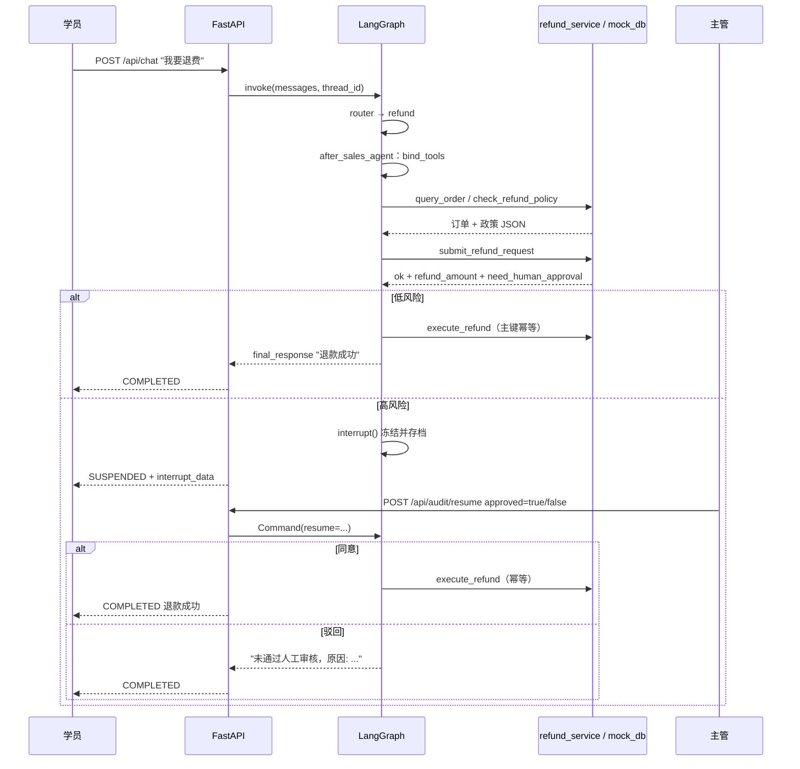
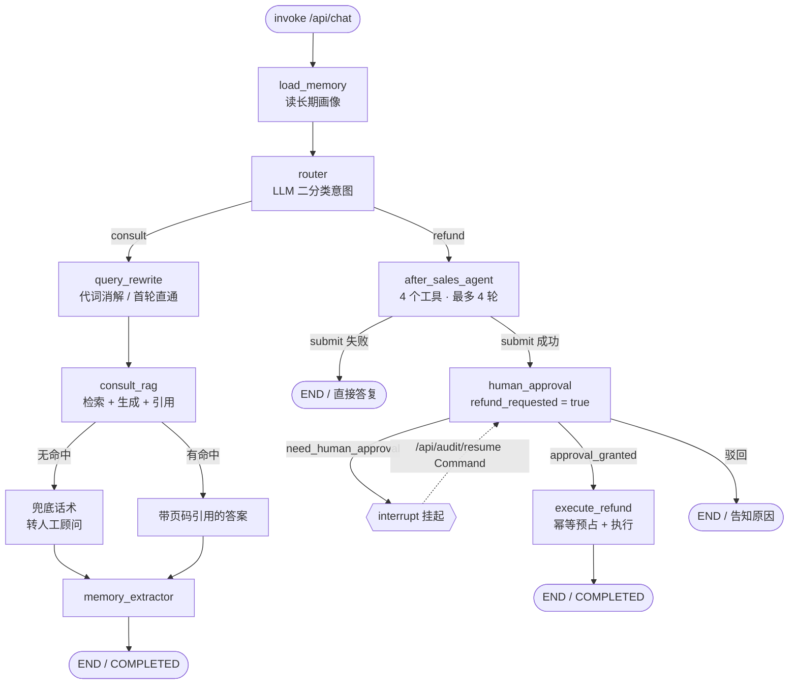

# 智能教育客服 Agent 全链路运行逻辑

> 2026-11 更新：退费分支已改为「工具调用 + 确定性兜底」（`after_sales_agent`），
> 工具清单与协议见 `docs/工具调用.md`；本文第 4、5.4、7、10、12、13 节已同步。

> 面向“从用户提出问题，到系统给出回答”的完整走查。所有结论都对应到仓库里的具体文件与行号。
> 项目本质：**LangGraph 显式状态机（意图路由 + 混合检索 RAG + 人工审批 HITL + 长短期记忆）**，
> 外挂 FastAPI 网关、SQLite 持久化、Langfuse 观测。

---

## 0. 一句话总结

用户一句话进来 → LangGraph 从 SQLite 里捞出该会话历史 → 读该用户长期画像 → LLM 判定“咨询 / 退费” →
咨询走「上下文改写 → 双路召回 → RRF 融合 → 规则精排 → 阈值截断 → 带页码引用生成答案 → 画像抽取落库」；
退费走「订单归属校验 → 政策阈值判定 → 命中高风险则 interrupt 挂起等人工 → 幂等 SQLite 预占 → 执行退款」。

---

## 1. 系统分层

| 层次 | 目录/文件 | 职责 |
| --- | --- | --- |
| 交互层 | `scripts/interactive_cli.py`、`server/main.py` | 命令行演示 / HTTP 接口 |
| 状态机层 | `core/agent_workflow.py` | LangGraph 图、节点、条件边、HITL、编译与持久化 |
| 检索层 | `core/rag_engine.py` | 向量 + BM25 双路召回、RRF、精排、阈值截断 |
| 记忆层 | `core/memory_manager.py` + `agent_state.db` | 长期画像（SQLite）/ 短期会话（checkpointer） |
| 业务层 | `server/mock_db.py`、`server/refund_store.py` | 模拟订单库 / 退款记录与幂等锁 |
| 数据层 | `scripts/ingest.py`、`data/`、`chroma_db/` | PDF 解析、切片、向量库构建 |
| 评测层 | `tests/`、`scripts/eval_rag.py`、`demo_rerank.py` | 回归测试、离线评测、链路演示 |

数据文件：

- `data/edu_policy.pdf`：业务规章主文档（6 个切片）。
- `data/distractors/*.txt`：课程目录、讲师介绍、学员故事、平台 FAQ、招生活动、AI 行业观察等干扰语料（约 24 个切片），用来验证检索不会“看到关键词就答”。
- `data/distractors/teacher_faculty.pdf`：另一所化妆学校的指南，`ingest.py` 通过 `skip_files` 明确跳过，不入库。
- `data/processed_chunks.md`：切片台账，供人工审查。
- `chroma_db/`：Chroma 持久化目录；`agent_state.db`：LangGraph 会话；`long_term_memory.db`：用户画像；`refund_records.db`：退款流水。

---

## 2. 阶段一：离线建库（`scripts/ingest.py`）

只跑一次（或规章更新时重跑）。执行 `python scripts/ingest.py` 后：

1. **扫描**：`DATA_PATH.rglob("*.pdf") + rglob("*.txt")`，递归读取 `data/` 及子目录（第 15-30 行）。
   通过 `skip_files = {"teacher_faculty.pdf"}` 跳过另一所化妆学校的指南；其余 PDF/TXT 统一进库。
2. **解析**：PDF 用 `PyPDFLoader(pdf).load()`，每页一个 `Document`；TXT 用
   `Document(page_content=..., metadata={"source": path.name, "page": 0})`（第 38-52 行）。
3. **切分**：`RecursiveCharacterTextSplitter(chunk_size=300, chunk_overlap=50)`，
   分隔符优先级 `["\n\n", "\n", "。", "！", "？", " ", ""]`（第 27-31 行）。
   → 中文按“先段落、再句子”切，尽量不把一句话劈成两半。
4. **打标**：每个切片写入 `source_file`（第 42-43 行），后续引用要靠它。
5. **导出台账**：把全部切片写进 `data/processed_chunks.md`，含来源文件与页码（第 53-59 行），
   这是“人工可审查”的证据链。
6. **重建向量库**：`delete_collection("edu_pdf_knowledge")` → `create_collection` → `add()`
   （第 65-88 行）。**每次全量重建，不做增量**，避免旧切片残留。
   `page` 存 `metadata["page"] + 1`（PyPDF 页码从 0 开始，展示时从 1 开始）。

当前产物：7 个文档（1 PDF + 6 TXT）共 30 个切片。分布：`edu_policy.pdf` 6、`ai_industry_news.txt` 3、
`campus_faq.txt` 5、`course_catalog.txt` 5、`marketing_promo.txt` 3、`student_stories.txt` 4、
`teacher_bios.txt` 4。业务规章覆盖课程定价、大纲、7 天无理由退款、人工审批、业务边界五类内容。

> 注意：Chroma 用默认 embedding（英文 MiniLM ONNX）。中文语义召回能力有限，
> 这正是本项目额外加 jieba + BM25 并用关键词覆盖率兜底精排的原因（见 §6）。

---

## 3. 阶段二：进程启动时发生了什么

### 3.1 `import core.rag_engine`（模块级副作用）

- 连接 `chroma_db`，`get_or_create_collection("edu_pdf_knowledge")`（第 11-12 行）。
- **一次性把全量切片读进内存**：`collection.get()`（第 15 行），构建 `CHUNKS` 列表。
- 对每条切片 `jieba.cut` 分词，构建 `TOKENIZED_CORPUS`，再建 `BM25Okapi`（第 28-31 行）。
- 打印“RAG 引擎就绪”。

含义：**服务启动时就把知识库全量加载进内存**，之后检索是纯内存计算 + 一次 Chroma 查询，毫秒级；
代价是知识库规模变大后启动变慢、内存占用线性增长，且 `ingest.py` 重建库后**必须重启服务**才能生效。

### 3.2 `import core.agent_workflow`

- `load_dotenv(BASE_DIR/.env, override=True)`（第 11 行）：让 `.env` 里的 Key 覆盖终端残留变量。
- `llm = ChatOpenAI(model="deepseek-chat", temperature=0, callbacks=[...])`（第 33-37 行）。
  `OPENAI_BASE_URL=https://api.deepseek.com` + `OPENAI_API_KEY` 让它指向 DeepSeek；
  `temperature=0` 保证路由/改写/答案尽可能确定。
- Langfuse `CallbackHandler` 用 `try/except ImportError` 包裹，没装或没配 Key 也能跑（第 26-31 行）。
- 定义 `AgentState`、8 个节点、条件边，`workflow.compile(checkpointer=SqliteSaver(conn))`（第 288-322 行）。
  `conn = sqlite3.connect("agent_state.db", check_same_thread=False)`，**所有会话共用一条连接**。

### 3.3 `import server.main` / `uvicorn`

- `sys.path.append(BASE_DIR)`，保证 `python server/main.py` 也能 import 到 `core`。
- 两个接口：`POST /api/chat`、`POST /api/audit/resume`；启动 `127.0.0.1:8000`。

---

## 4. 状态机的“变量表”

`AgentState`（第 44-60 行）：

| 字段 | 类型 | 谁写 | 用途 |
| --- | --- | --- | --- |
| `messages` | `Annotated[List[BaseMessage], add_messages]` | 入口输入、各节点 | **短期记忆**：同一 thread 自动追加，不覆盖 |
| `user_id` | str | 入口 | 订单归属校验、长期记忆主键 |
| `order_id` | Optional[str] | 入口 | 退费目标订单 |
| `intent` | `"consult"` / `"refund"` | router | 条件边分流依据 |
| `rewritten_query` | str | query_rewrite | 用于向量检索的独立问句 |
| `citations` | List[str] | consult_rag | 如 `《edu_policy.pdf》第1页` |
| `refund_amount` | float | after_sales_agent | 退款金额（来自 submit 结果） |
| `need_human_approval` | bool | after_sales_agent | 是否命中 7 天 / 10% 高风险 |
| `refund_requested` | bool | after_sales_agent | 是否已成功登记退款申请 |
| `refund_reason` | str | after_sales_agent | 申请时填写的原因 |
| `tool_events` | list | load_memory / after_sales_agent | 本轮工具调用记录 |
| `approval_granted` | bool | human_approval | 审批是否放行执行 |
| `final_response` | str | 各终点节点 | 最终答复 |
| `long_term_memory` | dict | load_memory | 跨会话画像 |

关键机制：`add_messages` 是 reducer，**传入的 `messages` 会追加而不是替换**；
其余普通字段是 last-write-wins，没被本轮节点写过的字段沿用 checkpoint 里的旧值。

---

## 5. 主链路：一次提问的完整旅程

### 5.1 HTTP 入口

```json
POST /api/chat
{"thread_id": "t-001", "user_id": "USER_A", "message": "Python 架构师训练营多少钱？", "order_id": null}
```

`main.py` 第 30-41 行：

```python
config = {"configurable": {"thread_id": req.thread_id}}
result = app_graph.invoke({
    "messages": [HumanMessage(content=req.message)],
    "user_id": ..., "order_id": ...,
    "citations": [], "need_human_approval": False
}, config=config)
```

- `thread_id` 决定读哪份会话 history；同一个 `thread_id` 多轮调用就是“同一通对话”。
- 只传了本轮这一条 `HumanMessage`，靠 reducer 拼到历史后面。

### 5.2 load_memory（入口第 1 站）

`get_user_long_term_memory(user_id)` 查 `user_profiles` 表；查不到返回默认
`{"learning_goal": "未知", "skill_level": "未知", "preferences": []}`（`memory_manager.py` 第 26-35 行）。

### 5.3 router（意图分类）

第 64-75 行，取**最后一条 HumanMessage**，用一个二分类 Prompt 让 LLM 只返回 `consult` / `refund`：

- 问“能不能退 / 规则是什么” → `consult`（走知识库）
- 说“我要退 / 帮我退钱 / 取消订单” → `refund`（走业务动作）

代码做了容错：`intent = "refund" if "refund" in res else "consult"`，
即使模型多吐了字，只要含 `refund` 就判定退费；否则一律按咨询处理（保守兜底）。

### 5.4 条件边

```python
def route_decision(state): return "query_rewrite" if state["intent"] == "consult" else "after_sales_agent"
```

### 5.5 query_rewrite（短期记忆 + 指代消解）

第 84-123 行：

- **首轮直接放行**：`len(messages) <= 1` 时 `rewritten_query = 原文`，省一次 LLM 调用。
- **多轮**：`trim_messages(max_tokens=1000, token_counter=len, strategy="last", start_on="human", end_on="human")`
  取最近若干条（注意 `token_counter=len` 实际按“消息条数”计数，不是 token 数，是个近似）。
- 把历史格式化成 `学员: ... / 客服AI: ...`，让 LLM 判断最新提问是否含“它 / 这个课 / 那门训练营”等指代，
  有则改写成**带完整主语的独立检索问句**，无则原样输出。
- 明确约束“严禁回答问题，只输出改写后的问句”，避免模型在这里就把答案说了。

这是「第二轮追问没有主语也能检索到正确文档」的关键：`它适合什么基础的人学？` → `Python 高级架构师训练营适合什么基础的人学？`。

### 5.6 consult_rag（RAG 生成）

第 126-186 行，五步：

1. **检索**：`search_knowledge_base(search_query, top_n=4)`（详见 §6），取 4 条切片。
2. **兜底**：`if not matched_chunks` → 固定话术
   “抱歉，关于该问题，官方文档与知识库中未检索到明确记录，已为您转接人工顾问处理。”
   **直接返回，不调用生成模型**——这是防幻觉的第一道闸门。
3. **拼上下文与引用**：每条切片生成引用标签
   `《{source}》第{page}页`，上下文写成 `[标签] 内容: ...`；最后 `list(set(citations))` 去重
   （副作用：引用顺序会丢，见 §12）。
4. **注入三层信息**：
   - 长期画像：`学员画像: 目标=..., 基础=..., 偏好=[]`
   - 知识库上下文（带页码标签）
   - 短期对话（最近 5 条再 trim，去掉最后一条本轮提问，作为“上文”）
5. **生成**：Prompt 三条硬约束——①只能依据参考文档，严禁发挥；②结合学员画像给建议；
   ③每个关键事实后必须打 `[《文件名》第X页]` 标记。

返回时把答案同时写进 `final_response` 和 `messages`（作为 `AIMessage`，供下一轮做上下文）。

### 5.7 memory_extractor（长期记忆沉淀）

第 189-210 行：拿本轮用户原话，让 LLM 判断是否透露了“基础 / 目标 / 偏好”，
有则回 JSON（如 `{"skill_level": "零基础", "learning_goal": "转行就业"}`），
`save_user_long_term_memory` 做 upsert 合并进旧画像；没有则 `{}`。
任何异常都 `except: pass`——记忆抽取是“锦上添花”，不能拖垮主流程（副作用：失败无感知）。

### 5.8 返回

`main.py` 第 44-58 行：

- 如果 `state.next` 非空 → 说明图停在 interrupt，返回 `status: "SUSPENDED"` + `interrupt_data`。
- 否则返回 `status: "COMPLETED"` + `response` + `rewritten_query` + `citations`。

CLI（`interactive_cli.py`）走同一套图，只是把结果打印到终端，并在挂起时模拟主管输入 1/2 审批。

---

## 6. 检索子系统：为什么是“双路 + RRF + 规则精排”

`core/rag_engine.py`，对外只有一个入口 `search_knowledge_base`（第 164-192 行）：

```
dense_search(query, 10) ─┐
                        ├─ 双路各 Top10 → RRF 融合 → 取前 12 → apply_reranker → 阈值 0.35 → 取前 top_n(4)
sparse_search(query, 10) ┘
```

### 6.1 两路粗排

**Dense（语义）** `collection.query(n_results=10)`，返回 `dense_distance`（越小越像）。
强项是同义改写、泛语义；弱项是“第 3 条 / 具体数字 / 专有名词”这类精确匹配。

**Sparse（关键词）** `jieba.cut(query)` → `bm25.get_scores()`，取分数最高且 `>0` 的 10 条。
强项是编号、术语、金额的精确命中；弱项是近义词、口语化表达。

两路各有短板，所以都要。

### 6.2 RRF 倒数排名融合（第 70-95 行）

```
score(doc) = 1/(60 + rank_dense + 1) + 1/(60 + rank_sparse + 1)
```

只看“名次”，不看原始分数，从而抹平“余弦距离”和“BM25 分数”量纲不一致的问题；
两路都靠前的切片自动排到最前，`k=60` 让名次差异平滑。

### 6.3 规则精排（第 121-161 行）

```
rerank_score = 0.8 × keyword_coverage + 0.2 × rank_score
keyword_coverage = 命中查询词数 / 查询词总数
rank_score = min(rrf_score / (该批最大 rrf_score × 1.05), 1)
```

两个工程细节：

- `normalize_text` 去掉所有空白/换行（第 98-104 行）。PDF 抽文常在词中间硬换行（“相关问\n题”），
  不归一化会让 `问题` 精确匹配失败，好切片被误杀。
- `extract_query_terms` 会丢掉“的/了/是/吗”等单字，以及“哪个/哪些/什么/怎么/多少/分别”这类疑问词（`QUERY_STOPWORDS`）。这些词几乎每句都有，留在分母会把覆盖率算虚高，让无关切片轻松过线；纯数字（如“10%”）仍保留。

为什么不能只用 RRF 归一化：RRF 是纯排名信号，Top1 归一化后恒约 0.95，第 2 名分差极小，
“低于阈值就丢弃”永远不触发，阈值形同虚设。引入绝对覆盖率后，**与问题毫无交集的切片覆盖率=0，
最高只能拿 0.2 分，永远过不了 0.35**——这才是真正拦得住“红烧牛肉面”的闸门。

### 6.4 阈值截断（第 164-192 行）

`threshold=0.35`：约等于“至少 20%~30% 的查询词能在切片里命中”。
低于阈值直接丢弃，不交给大模型；`top_n=4` 控制上下文长度与成本。

经验值：口语化业务可降到 0.30，要求更严可提到 0.45。

---

## 7. 退费链路与 HITL（工具调用版）

### 7.1 after_sales_agent（第 278-376 行）

`router` 判定 refund 后进入本节点，模型拿到 4 个工具：

| 工具 | 作用 | 是否写数据 |
| --- | --- | --- |
| `list_my_orders` | 列出本人订单 | 否 |
| `query_order` | 订单详情 + 政策判定 | 否 |
| `check_refund_policy` | 能否自动退 / 是否需人工 / 退多少 | 否 |
| `submit_refund_request` | 登记退款申请 | 是（只登记，不打款） |

执行循环：

1. `llm.bind_tools(tools)` 把工具 schema 挂到请求上，模型返回 `tool_calls`。
2. `_run_tool` 在本地执行工具，结果作为 `ToolMessage` 回填，再请求模型。
3. 最多 `MAX_TOOL_STEPS = 4` 轮，模型不再调用工具时结束。
4. 只有 `submit_refund_request` 成功，才把 `refund_requested=True`，并带上金额与风险标记。
5. 模型没调工具、但用户原话明确要求退款 → `refund_service` 确定性兜底提交。

工具内部（`core/refund_service.py`）：

- `find_order` 统一归属校验：不存在 / 非本人返回 `None`，提示语相同，防止订单号探测。
- `evaluate_refund` 判定 7 天与 10%（`> 7`、`> 0.10`）。
- `submit_refund_request` 查重后登记，不写订单状态、不打款。

### 7.2 human_approval（第 379-404 行）—— HITL 挂起点

- `refund_requested=False`（订单无效、重复提交、只问政策）→ 直接结束。
- `need_human_approval=False` → 直接放行。
- 命中高风险 → 调用 `interrupt({...})` 把执行**冻结**在这里：
  LangGraph 借 checkpointer 保存现场（`agent_state.db`），HTTP 请求立即返回，
  进程不占线程、不阻塞等待。
- 人工通过 `POST /api/audit/resume` 传入 `Command(resume={"approved": ..., "reject_reason": ...})`，
  图从 `interrupt()` 的返回值继续：
  - 同意 → `approval_granted=True` → 条件边去 `execute_refund`；
  - 驳回 → 返回“未通过人工审核，原因: ...”，条件边直接到 END，订单状态不变。

### 7.3 execute_refund（第 407-430 行）

1. **二次归属校验**（即使有人绕过图直接调函数也退不了别人的单）。
2. `refund_store.reserve_refund(order_id, user_id, amount)`：
   直接 `INSERT ... status='PROCESSING'`，**靠 `order_id` 主键唯一约束判重**。
   并发/重放/重启都由 SQLite 拦；不需要应用层锁，也不依赖内存。
3. 置订单 `REFUNDED` → `mark_refund_success` 把记录改 `SUCCESS`。
4. 若进程在 2、3 之间挂掉，记录停在 `PROCESSING`，正好留作对账线索，而不是被当成“已退好”。

### 7.4 时序



---

## 8. 记忆体系：两套库，职责不同

| | 短期记忆 | 长期记忆 |
| --- | --- | --- |
| 存储 | `agent_state.db`（LangGraph `SqliteSaver`） | `long_term_memory.db`（`user_profiles` 表） |
| 键 | `thread_id` | `user_id` |
| 内容 | 完整消息序列 + 全部 State 字段 | 结构化画像 JSON（目标/基础/偏好） |
| 生命周期 | 一次会话 | 跨会话、跨设备、永久 |
| 写入 | 每个节点执行后自动 checkpoint | `memory_extractor` 抽取后 upsert |
| 使用 | `add_messages` 自动拼历史；改写与生成时按窗口截取 | 入口 `load_memory` 注入，拼进 RAG Prompt |

- **会话隔离**：不同 `thread_id` 的 history 互不可见。
- **用户隔离**：长期画像按 `user_id` 物理隔离；`tests/test_memory.py::test_04` 验证新用户读到的是默认画像。
- **跨会话唤醒**：换一个全新 `thread_id`，只要 `user_id` 相同，`load_memory` 仍能拿到画像
  （`test_03_cross_thread_long_term_recall`）。
- **上下文不会无限膨胀**：写进 checkpoint 的历史是完整的，但**喂给模型的**只有 trim 后的窗口。

---

## 9. 可观测性（Langfuse）

`CallbackHandler` 在 `ChatOpenAI` 构造时注入（第 26-37 行），因此所有 `llm.invoke` 自动上报：

- 调用链：router → query_rewrite →（检索为本地调用，不在链上）→ consult_rag → memory_extractor；
- 每次调用的 prompt / completion / token 数与费用；
- 最终 Prompt 里带了哪些切片和页码标签，便于 Bad Case 归因。

`.env` 里的 `LANGFUSE_PUBLIC_KEY / SECRET_KEY / HOST` 配好即生效；没装包则自动降级为无观测。

---

## 10. 端到端走查（两个典型问句）

### 例 1：咨询（命中知识库 + 引用）

用户：`USER_A`，`thread_id=t1`，问“Python高级架构师训练营大概多少钱？学什么？”

1. `load_memory`：`USER_A` 查无画像 → 默认值。
2. `router`：LLM 判 `consult`。
3. `query_rewrite`：只有 1 条消息 → 直通，`rewritten_query = 原句`。
4. `consult_rag`：
   - dense 取 10、sparse 取 10（BM25 对“Python/架构师/训练营/多少钱”命中切片 #1/#2）；
   - RRF 融合后前 12 进精排；切片 #1（含 1999、适合人群）覆盖率最高 → `rerank_score` 最高；
   - 过 0.35 阈值，取前 4 条；
   - 拼出 `[《edu_policy.pdf》第1页] 内容: ...`，连同默认画像注入 Prompt；
   - 模型按“关键事实后打标签”的要求输出，答案含 `1999` 与 `[《edu_policy.pdf》第1页]`。
5. `memory_extractor`：本轮无画像信息 → 返回 `{}`，不写库。
6. 响应：`COMPLETED`，`citations` 含页码。

对应回归用例：`tests/test_regression.py::test_consultation_citations`
（断言 `1999` 与“第X页”）。

### 例 2：退费（自动 / 挂起）

用户：`USER_A` + `ORD_001`（3 天前、进度 5%、1999 元）说“申请退款”

1. `router` → `refund`（进入 `after_sales_agent`，**不走检索**）。
2. `after_sales_agent`：模型调用 `query_order` 查订单 → 调用 `submit_refund_request` 登记申请。
   `ORD_001` 未超 7 天、进度 5% ≤ 10% → `need_human_approval=False`、`refund_amount=1999`、`refund_requested=True`。
3. `human_approval`：无高风险 → 直接放行。
4. `execute_refund`：`reserve_refund` 插入 `PROCESSING` → 订单 `REFUNDED` → `SUCCESS`；
   再调一次 → `IntegrityError` → “该订单已提交过退款申请，请勿重复操作”。
5. 响应：“退款成功！退款金额 1999 元已原路退回。”，`tool_events` 里能看到两次工具调用。

高风险版本：`USER_B` + `ORD_002`（20 天前、进度 60%）→ `submit` 返回 `need_human_approval=true`
→ `interrupt` → HTTP 返回 `SUSPENDED` + `{"action": "REQUIRE_HUMAN_APPROVAL", ...}`，
订单仍 `PAID`；主管驳回 → “未通过人工审核，原因: ...”，订单仍 `PAID`。

---

## 11. 怎么跑、怎么验

```powershell
# 1. 建库（首次 / 规章变更后）
python scripts/ingest.py

# 2. 起服务
python server/main.py            # http://127.0.0.1:8000

# 3. 命令行体验（支持多轮、代词、审批中断）
python scripts/interactive_cli.py

# 4. 回归测试（会真实调用大模型）
pytest tests/test_regression.py -v -s

# 4.1 工具层 / 工具循环（不调用大模型）
pytest tests/test_tools.py tests/test_tool_agent.py -v

# 4.2 评测脚本自身（禁止词否定语境、标注集完整性、条款号分词）
pytest tests/test_eval_metrics.py tests/test_rag_engine.py -v

# 5. 检索链路演示：RRF / 精排 / 阈值 / 无关提问拦截
python demo_rerank.py

# 6. 离线评测（只评检索免费；--with-llm 才产生模型费用）
python scripts/eval_rag.py
python scripts/eval_rag.py --with-llm --limit 5 --output data/eval_report.md

# 6.1 消融：只走向量 / 只走 BM25，对比双路融合的贡献与延迟
python scripts/eval_rag.py --mode dense
python scripts/eval_rag.py --mode sparse

# 6.2 更难的标注集（跨切片、边界推理、拒答防幻觉）
python scripts/eval_rag.py --set data/eval_set_hard.jsonl --with-llm --output data/eval_report_hard.md
```

扩语料后（7 个文档 / 30 个切片），评测基线如下：

- easy（16 条）：检索 Recall@2 100%、MRR 0.917、应拒 100%；答案通过 100%、引用 100%、拒答 100%，
  P50 3358 ms / P95 5228 ms。
- hard（18 条）：检索 Recall@2 100%、MRR 0.962、应拒 40%；答案通过 94.4%、引用 100%、拒答 100%，
  P50 3872 ms / P95 5493 ms。
- 检索层剩下的 3 个失败是 h12/h13/h14（线下班、发票、就业承诺）：问题本身与“课程/报名/学员”有词面重叠，
  会误召回 1~5 条切片；答案层都能识别“文档未提及”并拒答，说明阈值拦截和生成层兜底要配合使用。
- 答案层唯一失败是 h09：AIGC 大纲在“企业级 / Function Calling”处被 300 字切片切断，
  模型看到了 RAG 切片，但对 Function Calling 只能回答“无法确认”。这是切片边界问题，不是检索完全没召回。

评测集字段：

- `must_contain`：可答用例必须出现的关键词；
- `must_not_contain`：不允许出现的说法（例如“保证就业”“1-3 个工作日到账”），用于抓幻觉；
- 判断禁止词时会识别否定语境，`无法保证就业` 不会被误判成承诺。

依赖（从 import 推断）：`fastapi uvicorn langchain-openai langchain-community langchain-text-splitters
langgraph langgraph-checkpoint-sqlite chromadb rank-bm25 jieba pypdf python-dotenv pytest httpx langfuse(可选)`。

---

## 12. 设计取舍与风险点（读代码时值得注意）

### 12.1 ✅ HITL 早退问题已修复

旧版 `human_approval_node` 用 `approval_granted` 做早退判断，而 `verify_refund` 在“需要审批”时
恰好把它置成 `False`，高风险订单会在 `interrupt()` 之前直接结束。

现在改成三个独立字段：

- `refund_requested`：有没有成功登记申请（订单无效 / 重复提交 → False）；
- `need_human_approval`：要不要人工审批（7 天 / 10% 判定）；
- `approval_granted`：只表示审批结果。

`human_approval_node` 只在 `refund_requested=False` 时提前结束，高风险订单会正常 `interrupt`。
回归用例 `test_high_risk_refund_interrupt_and_resume` 覆盖这条路径。

### 12.2 订单库是内存态，退款记录是持久态

`mock_db.MOCK_ORDERS` 进程重启即重置为 `PAID`，但 `refund_records.db` 里仍是 `SUCCESS`。
结果：服务重启后同一订单再次申请会被幂等键拦住（钱不会被重复退），但订单状态显示 `PAID`，
对账口径不一致。生产上订单状态必须来自同一个持久化数据库。

### 12.3 政策阈值仍有两份

阈值现在集中在 `core/refund_service.py`（`REFUND_WINDOW_DAYS=7`、`MAX_LEARNED_PROGRESS=0.10`），
代码里不再重复；但知识库文档第 3/4 条还有一份文字描述。
文档改了代码不改，仍会出现“客服说可以、系统判不行”，建议把两者接到同一份配置。

### 12.4 每轮 3~5 次 LLM 调用

- 咨询：`router` + `query_rewrite`（多轮才有）+ `consult_rag` + `memory_extractor`，首轮约 3 次。
- 退费：`router` + 工具循环 2~4 次（每次都是完整请求，上下文还会越来越长）。
可考虑：意图用小模型/规则、路由与改写合并、记忆抽取改成后台任务、工具循环里限制上下文长度。

### 12.5 其他

- `list(set(citations))` 丢顺序，引用可能“第2页”排在“第1页”前；用 `dict.fromkeys` 保序。
- `/api/audit/resume` 只凭 `thread_id` 恢复，没有审批人身份/权限校验；`thread_id` 即“能力凭证”。
- `SqliteSaver` 用单条连接 + `check_same_thread=False`，FastAPI 同步接口跑在线程池，
  高并发下建议每线程一条连接或换 Postgres checkpointer。
- `trim_messages(token_counter=len)` 按消息条数而非 token 计，窗口大小与预期有偏差。
- `memory_extractor` 的 `except: pass` 会吞掉 JSON 解析失败、网络失败，画像静默缺失。
- Chroma 默认英文 embedding，中文语义召回偏弱；本项目用 BM25 + 覆盖率精排补足，但换库时要注意。
- `.env` 明文存放 API Key 且 `override=True`，别提交到公开仓库。
- `README.md` 里的 `agent.py`、`mock_db.py` 平铺结构已过时，实际是 `core/`、`server/`、`scripts/` 分包。

---

## 13. 附：完整状态图



读代码建议顺序：
`scripts/ingest.py` → `core/rag_engine.py` → `core/memory_manager.py` →
`core/agent_workflow.py`（State → 各节点 → 图）→ `server/main.py` → `tests/test_regression.py`。
