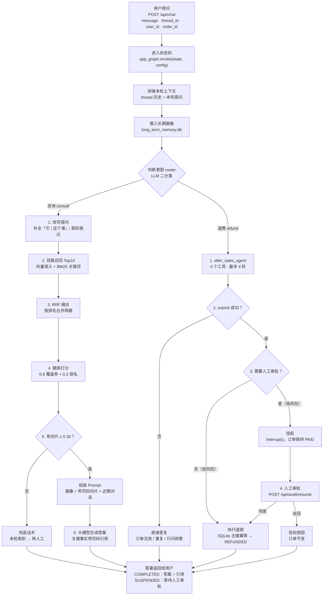
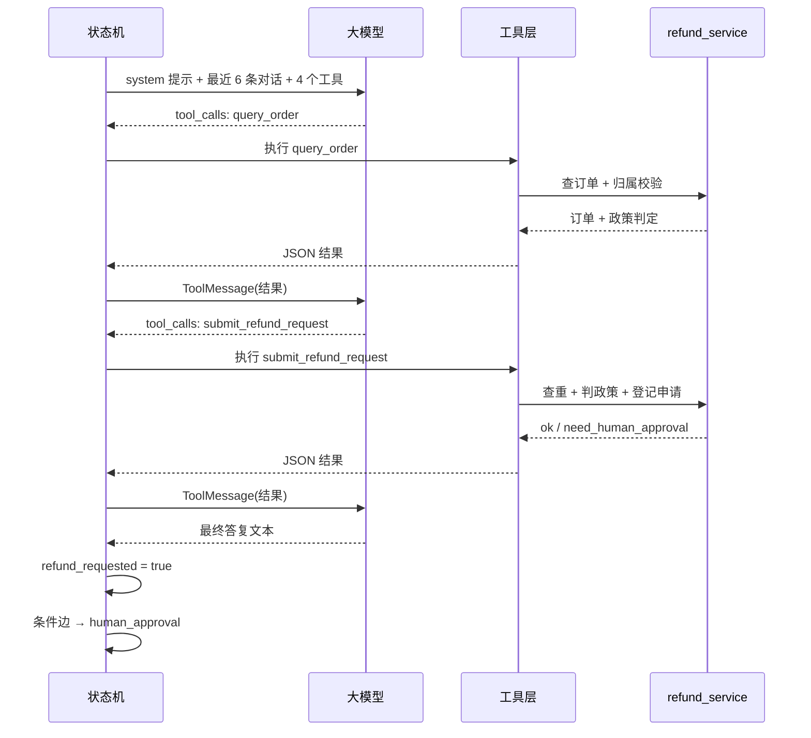

# 从提问到回答 · 在线链路图（含工具调用）

> 只画**一次对话**从「用户提问」到「答案返回」的在线路径。
> 退费分支已改为工具调用（`after_sales_agent`），协议细节见 `docs/工具调用.md`；
> 离线建库、服务启动、数据库结构见 `docs/运行逻辑.md` 与 `docs/流程图.md`。
> 配套静态图：`docs/问答流程图.svg`（浏览器直接打开）。

## 1. 主流程

## 2. 工具循环内部（退费分支）

## 3. 每一步在做什么

| 步骤 | 输入 | 输出 | 为什么需要 |
| --- | --- | --- | --- |
| 进入状态机 | 本轮消息 + `thread_id` | 加载该会话的完整状态 | 同一个 `thread_id` 才算同一通对话 |
| 拼接上下文 | 历史消息 + 本轮提问 | `messages` 追加一条 | 代词消解和连贯追问都依赖它 |
| 载入长期画像 | `user_id` | 目标 / 基础 / 偏好 | 跨会话个性化，换个窗口也记得你 |
| 判断意图 | 最后一条用户消息 | `consult` / `refund` | 咨询走知识库，退费走业务动作，风险等级不同 |
| 改写提问 | 历史 + 本轮问题 | 独立检索问句 | 「它多少钱」不补主语就检索不到 |
| 双路召回 | 改写后的问句 | 各 10 条候选 | 向量擅长语义，BM25 擅长编号/术语 |
| RRF 融合 | 两路候选 | 统一排序，取前 12 | 两条链路分数量纲不同，只能比名次 |
| 精排 + 阈值 | 候选切片 | 最多 4 条留用 | 用「关键词覆盖率」这个绝对证据拦掉无关内容 |
| 组装 Prompt | 画像 + 切片 + 近期对话 | 最终提示词 | 让模型只依据文档回答，并知道对谁说话 |
| 生成答案 | Prompt | 带页码引用的回答 | 可溯源，便于人工复核 |
| 工具调用 | 最近 6 条消息 + 工具清单 | `tool_calls` | 模型自己决定查订单还是提交申请 |
| 工具执行 | 工具名 + 参数 | JSON 结果 `tool_events` | 真正读写业务数据的是本地代码，不是模型 |
| 提交申请 | `order_id` + `reason` | `refund_requested=True` | 只登记申请，不直接打款 |
| 人工审批 | `need_human_approval` | 放行 / 驳回 / SUSPENDED | 高风险资金操作必须有人把关 |
| 执行退款 | 订单号 + 金额 | `REFUNDED` + 流水 | SQLite 主键幂等，重复请求退不了两次 |

## 4. 四个容易忽略的细节

1. **任何一条路径最后都落到「答案」**：咨询的命中/兜底、退费的成功/驳回/无效订单，最终都写入
   `final_response` 返回；只有触发 HITL 时返回的是 `SUSPENDED` 而不是答案，等人审批后再恢复。
2. **检索失败不会交给大模型**：阈值过滤在生成之前，没命中就直接用固定话术，这是防幻觉的关键。
3. **退费路径不经过 RAG**：金额、天数、进度来自 `mock_db` 与 `refund_service` 的规则，
   工具返回的是结构化 JSON，不靠模型“读文档”。
4. **工具只读和登记，不打款**：`submit_refund_request` 成功只置 `refund_requested=True`，
   真正的 `REFUNDED` 由 `execute_refund` 执行；模型不调工具时还有确定性兜底。

## 5. 渲染方式

- 直接看图：双击 `docs/问答流程图.svg`（Chrome / Edge）。
- 改图：把上面的 Mermaid 粘到 [mermaid.live](https://mermaid.live)，或在 VS Code 装
  “Markdown Preview Mermaid Support” 后预览本文件。
